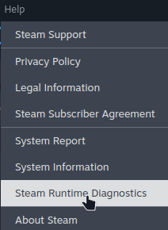
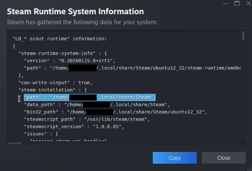

# Proton 10 Experimental Bleeding Edge with Hoshino Lina's Patch
## Custom patched Proton for the Unity extreme memory leak that occurs with some version of mono's garbage collector

This is a fork of [Wine-TKG-Git](https://github.com/Frogging-Family/wine-tkg-git) that includes a patch by Hoshino Lina that fix's a bug in Wine that can lead to extreme memory leak in some version's of mono's garbage collector which is used in some versions of Unity.

Specifically, this is intended to fix things for Warudo and other software that uses those specific versions of Unity/Mono GC.

This also includes some specific workarounds for Warudo to make launching it as simple as possible, and prevent a slow memory leak.

## Notes

The ideal solution would be a fix applied directly to Wine and adopted in to Valve Wine, and for software using that Unity/Mono GC library to upgrade to a newer version of the GC library that handles these exceptions without the leak.

Unfortunately it can takes months or more to get a fix like this in to the Wine source and then in to Valve's Wine source, and then in to a version of Proton that is easily accessible for users.

This works as a stop-gap solution until all of that happens.

## Usage

1. **Download the latest release:**
- [TKG Proton Experimental - Lina Unity Leak Patch - Valve Proton v4 rev2](https://github.com/madalee-com/wine-tkg-git-lina-unity-leak-fix/releases/tag/v4-tkg-valve-r2)

2. **Extract the zip to the compatability tools path:**
- For directly installed Wine: `~/.local/share/Steam/compatibilitytools.d/` or `~/.steam/<something>/Steam/compatibilitytools.d/`
- For Flatpack Wine: `~/.var/app/com.valvesoftware.Steam/.local/share/Steam/compatibilitytools.d/`
- For other installation methods, you can find your compatabilitytools.d path by:
    1. In Steam, click "Help->Steam Runtime Diagnostics"
    2. In the window that opens look for "path" under steam installation
    3. The correct path should be `<path>/compatibilitytools.d`

         
3. **Restart Steam if it's already running**

### If you are trying to use Spout2PW
You may get an error when starting Warudo with spout2pw saying **"Installation unsuccessful"**.
If this happens:
- Switch to Proton Experimental
- Try to start Warudo(it's okay if it crashes, just so long as Spout gets setup and says **"Installation successful"**).
- Then switch back to this patched Proton and everything should work.

## Acknowledgements

- 99.9% of this project is: https://github.com/Frogging-Family/wine-tkg-git
- [Hoshino Lina](https://github.com/hoshinolina) for making the patch
- [AdalynBlack](https://github.com/AdalynBlack) for helping to isolate the actual bug
- [Madalee](https://github.com/madalee-com) for putting this fork together

---

# Wine to rule them all !

You must be logged in to GitHub in order to download Wine or Proton nightly builds.

## Wine nightly builds

- wine-staging patchset applied
- ntsync support added as needed

Wine | [Arch Linux](https://github.com/Frogging-Family/wine-tkg-git/actions/workflows/wine-arch.yml) | [Fedora](https://github.com/Frogging-Family/wine-tkg-git/actions/workflows/wine-fedora.yml) | [Ubuntu](https://github.com/Frogging-Family/wine-tkg-git/actions/workflows/wine-ubuntu.yml) |
-------------|--------|--------|-------|

Valve Wine | [Exp Bleeding Edge Arch Linux](https://github.com/Frogging-Family/wine-tkg-git/actions/workflows/wine-valvexbe-pacman.yml) | [Exp Bleeding Edge Other distro](https://github.com/Frogging-Family/wine-tkg-git/actions/workflows/wine-valvexbe.yml) |
-------------|--------|--------|-------|

*The Exp Bleeding Edge Other distro versions are built on Ubuntu latest, which should work fine on most distros not using years old packages*

## Proton nightly builds

- wine-staging patchset applied
- wine master version is built against Arch current, making glibc 2.42+ a requirement
- valve exp be version is built against the sniper container
- ntsync support added as needed

Proton | [Valve Exp Bleeding Edge](https://github.com/Frogging-Family/wine-tkg-git/actions/workflows/proton-valvexbe-sniper.yml) | [Wine Master (hit or miss edition)](https://github.com/Frogging-Family/wine-tkg-git/actions/workflows/proton-arch-nopackage.yml) |
-------------|--------|--------|

(drop the extracted folder in `/$HOME/.steam/root/compatibilitytools.d/` or, for Ubuntu/Debian based, the `/$HOME/.steam/compatibilitytools.d/` dir)

## PLEASE DO NOT REPORT BUGS ENCOUNTERED WITH THIS AT WINEHQ OR VALVESOFTWARE, REPORT HERE INSTEAD !

Wine-tkg is a build-system aiming at easier custom wine builds creation. You can now easily get the "plain wine + pba + steam fix" build you've been dreaming about!

It can also make custom Proton builds with its wrapping script: https://github.com/Frogging-Family/wine-tkg-git/tree/master/proton-tkg

**By default, it'll pull current wine/wine-staging git versions. You can target a specific release or commit in the .cfg if needed.**

A comfortable selection of patches is available to you, with some of them being enabled by default for your convenience (see [this sample config file](https://github.com/Frogging-Family/wine-tkg-git/blob/master/wine-tkg-git/wine-tkg-profiles/sample-external-config.cfg) for the full list and details)

An ever evolving selection of staging, experimental and/or hacky patches are also available [in the community-patches](https://github.com/Frogging-Family/community-patches/tree/master/wine-tkg-git)

**Can be built with your own patches - See [README in wine-tkg-git/wine-tkg-userpatches](https://github.com/Frogging-Family/wine-tkg-git/blob/master/wine-tkg-git/wine-tkg-userpatches/README.md) for instructions**

### Generated Wine-tkg sources (staging-based):
 - Wine-tkg : https://github.com/Tk-Glitch/wine-tkg
 - Proton-tkg : https://github.com/Tk-Glitch/wine-proton-tkg

Wine : https://github.com/wine-mirror/wine

Wine-staging : https://github.com/wine-staging/wine-staging

Wine esync : https://github.com/zfigura/wine/tree/esync

Wine fsync : https://github.com/zfigura/wine/tree/fsync

Proton : https://github.com/ValveSoftware/Proton

Wine-pba (Only working correctly up to 3.18 - Force disabled on newer wine bases due to regressions) : https://github.com/acomminos/wine-pba

Thanks to @Firerat and @bobwya for their rebase work :
- https://gitlab.com/Firer4t/wine-pba
- https://github.com/bobwya/gentoo-wine-pba

For Gallium 9 support, use https://github.com/iXit/wine-nine-standalone (available from winetricks and AUR) - Legacy nine support can still be turned on if you're building a 4.1 base or older.
